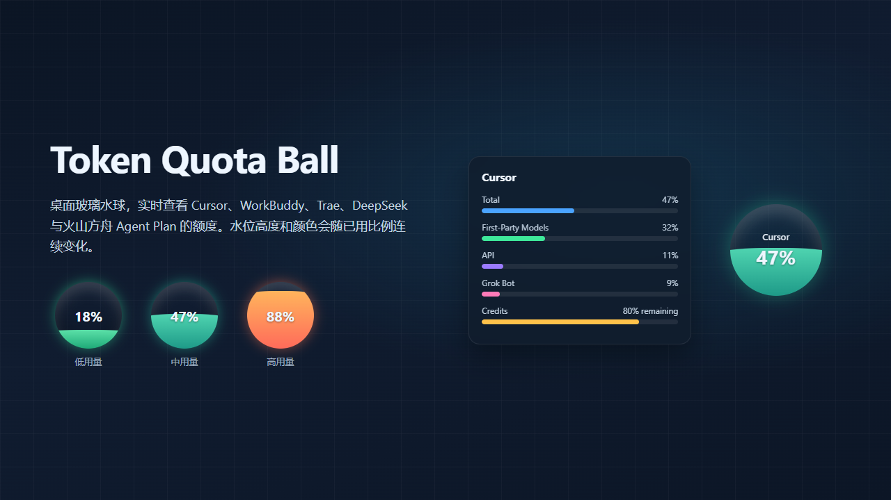

# Token Quota Ball

Windows 桌面额度悬浮球：在桌面置顶显示一颗玻璃水球，实时查看 **Cursor**、**WorkBuddy**（腾讯办公 Agent）、**Trae**、**DeepSeek** 和火山引擎 **火山方舟 Agent Plan** 的用量。

没有系统标题栏，也没有方形边框。水位高度和颜色会随已用比例连续变化。



*示意截图，数据为虚构，不涉及真实账号。左侧三颗小球分别示意低 / 中 / 高用量时的水位与颜色。*

<p align="center">
  
  
</p>

## 下载安装

1. 打开 [Releases](../../releases)，下载最新的 **NSIS 安装包**（`Token Quota Ball_x.x.x_x64-setup.exe`）。
2. 安装后从开始菜单启动即可。
3. **不必**再安装 Python、Node.js 或 Rust。

请只开一个球。若启动失败，可在任务管理器中结束残留的 `token-quota-ball.exe` / `token-quota-ball-api.exe` 后再试。

## 支持的服务

| 服务 | 如何接入 | 球上主要显示 |
|------|----------|--------------|
| Cursor | 自动读取本机已登录的 Cursor | Included Usage 已用百分比 |
| WorkBuddy | 自动读取本机已登录的 WorkBuddy 桌面端 | 当前积分包已用比例；企业无限额度时显示「不限」 |
| Trae | 自动读取本机已登录的 Trae CN | 积分已用比例 |
| 火山方舟 Agent Plan | 设置里填写火山引擎 IAM 访问密钥 | 四个时间窗口中已用占比最高的一项（AFP） |
| DeepSeek | 设置里填写 API Key | 账户余额（官方无周期额度上限） |

未登录或未配置时显示 `--` 并说明原因，不会用假数据冒充真实额度。当前选中的提供方会记住。

## 怎么用

- **拖动**：按住球体移动，松手后记住位置。拖到屏幕边缘松开可贴边隐藏；鼠标移上去会暂时滑出。
- **悬停**：查看用量条和状态；移开后自动收起。
- **单击**：打开详情（账户、套餐、用量、重置时间等）。点窗外或按 `Esc` 关闭。
- **右键**：打开详情、刷新、切换额度、提供方设置、贴边隐藏、退出。

## 外观

- 玻璃质感水球 + 柔和光晕；球上显示提供方名称和用量文案。
- 水位表示已用比例：偏低偏青绿 → 升高转暖黄 → 接近用尽偏红，过渡平滑。
- 水面有缓慢波纹，水下有细小光尘。

DeepSeek 较特殊：官方只返回余额，球上默认显示金额。若填写了可选的「参考额度」，才会按「参考额度 − 余额」显示水位占比。

## 配置提供方

Cursor、WorkBuddy、Trae **不用在本工具里填密钥**，用本机已经登录的桌面端即可。右键 →「切换额度」选中对应项。

需要手动配置的只有：

- **火山方舟 Agent Plan**：火山引擎 IAM 的 Access Key ID / Secret Access Key（不要填模型推理 API Key）。企业版还需席位 ID。
- **DeepSeek**：API Key；可选填写参考额度，仅用于水位显示。

球体右键 → **提供方设置…**。可先「测试」（不会写入配置），确认无误后再「保存」。密钥只保存在本机，界面以掩码显示；请勿发给别人或贴到聊天里。

安装版配置与日志位于：

`%APPDATA%\TokenQuotaBall\`

（`config\` 存设置，`logs\` 存日志与窗口位置）

## 隐私与安全

本工具只在本机查询额度：会读取本机已登录的 Cursor / WorkBuddy / Trae 会话，或你填写的火山方舟 / DeepSeek 密钥。请仅用于自己的电脑和自己的账号。详见 [SECURITY.md](SECURITY.md)。

## 开机自启（可选）

若从源码使用，可用：

```bat
scripts\install-autostart.bat
scripts\uninstall-autostart.bat
```

已用安装包安装时，也可自行把开始菜单快捷方式复制到「启动」文件夹。

## 从源码构建（开发者）

面向贡献者与自行打包的用户；普通用户请直接下载 Releases。

1. 安装 Python 3.10+、Node.js 20+、Rust 1.77.2+
2. `pip install -r requirements.txt`
3. 开发运行：`scripts\run-tauri.bat`
4. 打独立安装包：`scripts\build-tauri.bat`（会冻结 API sidecar 并产出 NSIS；最终用户无需 Python）

更多约定见 [CONTRIBUTING.md](CONTRIBUTING.md)。本地自检：`pytest`、`npm run build:ui`、`cd src\tauri && cargo check`。CI 见 `.github/workflows/ci.yml`。

## 许可证

[MIT](LICENSE)
